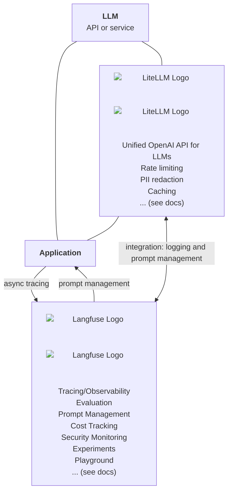
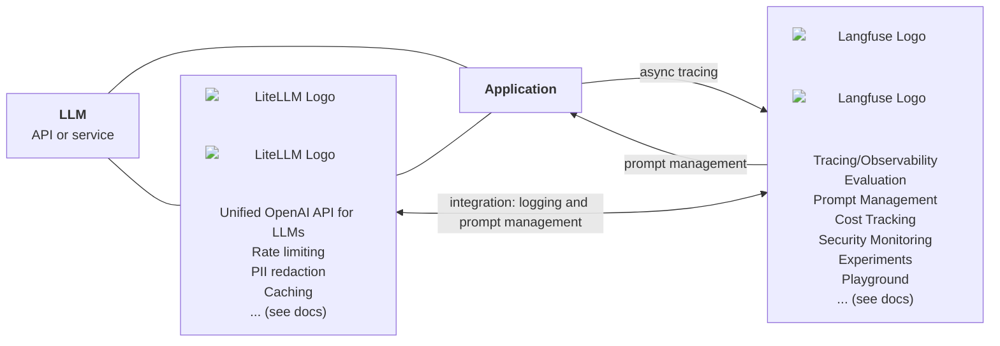
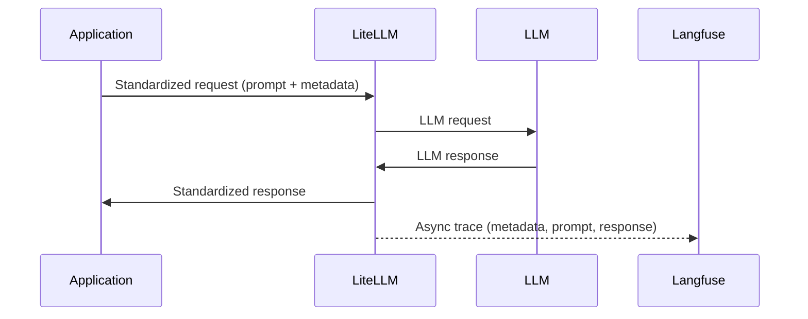

# Open Source LLMOps Stack

## Introduction

Choosing the right technology stack is one of the most critical decisions teams must make when building LLM-powered applications. The wrong choices can lead to vendor lock-in, limited flexibility, and high switching costs, all of which can stifle innovation and slow down iteration cycles.

Thus we introduce the "Open Source LLMOps Stack" as an open, well-integrated, scalable, and established setup backed by large OSS communities. It includes [LiteLLM](https://docs.litellm.ai/docs) ([GitHub](https://github.com/BerriAI/litellm)) as an LLM Proxy/Gateway and [Langfuse](https://langfuse.com/docs) ([GitHub](https://github.com/langfuse/langfuse)) for Observability, Evaluation and Prompt Management.

Selection of users/contributors:

  
  
  
  
  
  
  
  

  
  
  

> "Our experience with LiteLLM and Langfuse at Lemonade has been outstanding. LiteLLM streamlines the complexities of managing multiple LLM models, while Langfuse provides clear, actionable insights for monitoring and optimizing our AI applications. Being able to host this stack within our infrastructure has been a game-changer, and we're particularly impressed with the rapid development pace of both projects." — Mark Koltnuk, Principal Architect (GenAI Platform) at [Lemonade](https://lemonade.com)

> "Generative AI technology evolves at an unprecedented rate. LiteLLM is an amazing product that helps our Engineering teams quickly prototype, launch, and deliver new AI features at scale. Langfuse instrumentation gives our teams the visibility to quickly pinpoint issues across our LLMops stack and resolve them in minutes. Together, these products are essential at Fletch and consistently deliver best-in-class experiences for our customers." — Darien Kindlund, VP of Technology at [Fletch](https://fletch.ai)

> "LiteLLM x Langfuse has improved our iteration speed and monitoring capabilities by 10x. Langfuse's crisp documentation allowed Decisional to deploy detailed LLM observability and evaluation locally in less than half a day. This instrumentation caught multiple bugs within a week, saving us hundreds of hours (not exaggerated) of dev time. LiteLLM's model picker made it really easy to switch between model providers and add failovers." — Adit Sanghvi, CTO at [Decisional](https://decisional.works)

You can [deploy](/docs) this stack in a matter of minutes via the templates (HELM or docker compose) in your own environment. Read on to learn more.

## LiteLLM [#litellm]

> Unified LLM API (OpenAI Format), Cost Allocation, Model Access Management

[**LiteLLM**](https://docs.litellm.ai/docs) is an open-source Python SDK, Proxy Server (LLM Gateway) to call 100+ LLM APIs in OpenAI format - [Bedrock, Azure, OpenAI, VertexAI, Cohere, Anthropic, Sagemaker, HuggingFace, Replicate, Groq]. It offers teams:

**Unified LLM API (OpenAI Format)**

- [**OpenAI-Compatible API**](https://docs.litellm.ai/docs/providers) - Access 100+ LLMs in the OpenAI format: Bedrock, VertexAI, Anthropic, Hugging Face, vLLM and more.
- [**Built-in failover mechanisms**](https://docs.litellm.ai/docs/proxy/reliability) - Automatically switch to alternative models if a provider is down.
- [**Load balancing**](https://docs.litellm.ai/docs/proxy/load_balancing) - Distribute traffic efficiently across multiple LLMs for scalability and reliability.

**Observability & Cost Management**

- [**Logging & request tracking**](https://docs.litellm.ai/docs/proxy/logging) - Capture logs of all requests and responses for debugging and analysis.
- [**Model Access Controls**](https://docs.litellm.ai/docs/proxy/virtual_keys) - Control access to models by virtual keys, teams
- [**Budgets & Rate Limits**](https://docs.litellm.ai/docs/proxy/users) - Track spend and set budget limits across models, keys, teams and custom tags
- [**Prompt versioning & A/B testing**](https://docs.litellm.ai/docs/proxy/prompt_management) - Manage different prompt iterations and compare effectiveness.

**Model Access Management**

- [**Virtual Keys**](https://docs.litellm.ai/docs/proxy/virtual_keys) - Control access to models by virtual keys, teams and model access groups
- [**Self-serve Portal (SSO)**](https://docs.litellm.ai/docs/proxy/ui) - Allow teams to login via SSO and manage their own keys in production with a self-serve key management portal

## Langfuse [#langfuse]

> Open-source AI engineering platform for observability, evaluation, and prompt management

<iframe
  width="100%"
  className="aspect-[16/9] rounded border w-full mt-10"
  src="https://www.youtube-nocookie.com/embed/2E8iTvGo9Hs?si=bT3wbaxdv2DIBCBo"
  title="YouTube video player"
  frameBorder="0"
  allow="accelerometer; autoplay; clipboard-write; encrypted-media; gyroscope; picture-in-picture; web-share"
  referrerPolicy="strict-origin-when-cross-origin"
  allowFullScreen
></iframe>

[**Langfuse**](https://langfuse.com/docs) is an open-source AI engineering platform that helps teams collaboratively debug, analyze, and iterate on LLM applications. It complements LiteLLM with an integrated workflow across production traces, prompts, evaluations, and experiments:

- [**Observability**](https://langfuse.com/docs/observability/overview): Trace LLM and agent applications with OpenTelemetry, native SDKs, or integrations. Inspect LLM calls, retrieval, embeddings, tool calls, and other application logic across traces and sessions, while monitoring quality, cost, and latency.
- [**Prompt Management**](https://langfuse.com/docs/prompt-management/overview): Centrally manage, version, test, and deploy prompts. Client-side caching minimizes retrieval latency, while fallbacks improve availability.
- [**Evaluation**](https://langfuse.com/docs/evaluation/overview): Capture online and offline evaluations in one place using LLM-as-a-judge, code-based evaluators, user feedback, human annotation, or custom pipelines via the APIs and SDKs.
- [**Datasets and Experiments**](https://langfuse.com/docs/evaluation/experiments/datasets): Build test sets and benchmark changes to prompts, models, or application logic via the UI, SDKs, or CI/CD.
- [**Playground**](https://langfuse.com/docs/prompt-management/features/playground): Test and compare prompts and model configurations, then move successful iterations into production.
- [**Open Data Platform**](https://langfuse.com/docs/api-and-data-platform/overview): Access Langfuse data and features through public APIs, typed Python and JavaScript/TypeScript SDKs, a CLI, and an MCP server to build custom LLMOps workflows.

## Integration

LiteLLM and Langfuse integrate directly, thereby you can use LiteLLM as a central model gateway and Langfuse for observability, evals and prompt management. To learn more, see the [integration docs](https://docs.litellm.ai/docs/proxy/logging#langfuse).

<Callout type="info">
  Using Langfuse Prompts directly via LiteLLM is currently in beta
  ([docs](https://docs.litellm.ai/docs/proxy/prompt_management)). Thereby you
  can only pass the prompt variables to the LLM request and all prompt
  fetching/caching is done by LiteLLM. Alternatively, you can rely on the
  Langfuse SDKs to use prompts in your application code
  ([docs](https://langfuse.com/docs/prompts/get-started)).
</Callout>

## Why This Stack?

Choosing the right LLM Ops stack is critical for teams that require long-term flexibility, scalability, and control over their AI infrastructure. Many proprietary solutions impose vendor lock-in, limiting adaptability and making it difficult to iterate on workflows as technology evolves.

By adopting the **Open-Source LLM Ops Stack**, teams gain:

- **Self-Hosting & Open Source** - Both LiteLLM and Langfuse are open-source, allowing teams to deploy them in their own infrastructure while ensuring complete control over their LLM operations.
- **Technology Independence** - Avoid reliance on a single cloud provider or LLM vendor, ensuring the ability to switch models and providers with minimal friction.
- **Enterprise-Ready & Scalable** - These tools are built to handle large-scale deployments with robust performance, failover mechanisms, and high-availability setups.
- **Battle-Tested & Well-Documented** - Both projects (with a combined 25K Github Stars) are widely used in production environments and offer extensive documentation to support engineering teams.
- **Large Community & Active Development** - A vibrant open-source community actively contributes to both LiteLLM and Langfuse, ensuring continuous improvements, feature additions, and long-term viability.

## Getting Started with the Open Source LLMOps Stack

Deploying the stack is straightforward:

1. Deploy LiteLLM and Langfuse
2. Setup Integration by enabling callbacks from LiteLLM to Langfuse
3. Use LiteLLM gateway endpoints across your application
4. (optional) Setup evals and prompt management in Langfuse
5. Done

👉 [Follow the step-by-step tutorial](/docs)

## Questions/Feedback?

We are very much looking forward to your feedback!

- OSS LLMOps Stack: [Repo](https://github.com/langfuse/oss-llmops-stack)
- LiteLLM: [Issue tracker](https://github.com/BerriAI/litellm/issues), [Discord](https://discord.com/invite/wuPM9dRgDw)
- Langfuse: [Issue tracker](https://github.com/langfuse/langfuse/issues), [GitHub Discussions](https://github.com/langfuse/langfuse/discussions), [Discord](https://langfuse.com/discord), [Ask AI](https://langfuse.com/docs/ask-ai)
